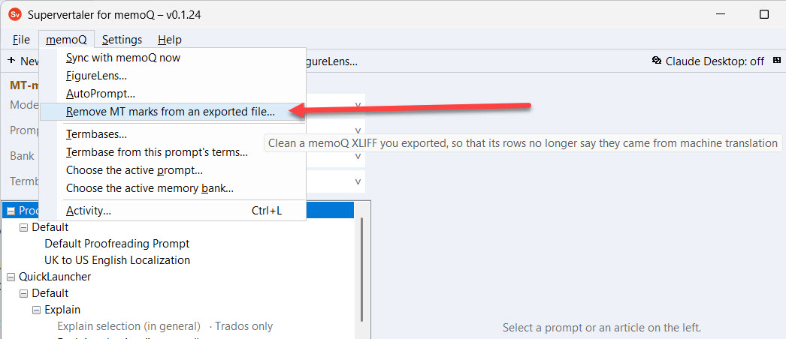

memoQ remembers which rows were filled by machine translation. Click such a row and the Review tab of the View pane says *machine translation from MT / Supervertaler* under **Inserted match** – or DeepL, or whichever engine it was. The same record goes to whoever receives your work: it is in the edit distance report, in bilingual exports and in what a project sends back. Rewriting the row and confirming it does not clear it, and neither does deleting the text and typing it again.

Once you have reworked a segment, the translation is yours. **Remove MT marks**, in the Supervertaler editor, takes the marks out, so those rows read like any you typed yourself.

### What it removes, and what it leaves

It removes the record memoQ keeps of every machine translation inserted into a row – from Supervertaler or any other engine, memoQ's own AGT included – both from the row and from the earlier versions in the row's history. A row still waiting to be confirmed loses its *Machine translated* status and becomes *Edited*.

Everything else stays exactly as it was: your translations, comments, the status of confirmed rows, and translation memory matches, which keep their match rate.

### Removing the marks

Do this when the translation is finished, just before you deliver.

1. **Export.** In **Project home → Translations**, select the documents – all of them, if you like – and choose **Documents → Export → Export Bilingual**. Pick **memoQ XLIFF** and tick **Include skeleton and preview**; memoQ then ticks **Save a compressed file (.mqxlz)** as well. Save the files into a folder of your choice.
2. **Clean.** In the Supervertaler editor, choose **memoQ → Remove MT marks from an exported file…** and select the files you just exported. The editor writes a clean copy of each, under the same name, into a **Clean** folder beside them, and reports how many marks it removed and from which engines. The files you exported are not changed.

   

3. **Remove the documents from the project.** Back in **Project home → Translations**, select the same documents and remove them from the project. If **Remove** is greyed out, the documents came in a Trados package: see [Projects from a Trados package](#projects-from-a-trados-package).
4. **Import the clean copies.** Choose **Documents → Import → Import with options**, open the **Clean** folder and select every file in it (Ctrl+A). In the **Document import options** window the action must say **Import as new**. Click **OK**.
5. **Check.** Open a document and click a row: the Review tab no longer shows an **Inserted match** line.

The documents come back with the same internal IDs as before, so memoQ treats them as the same documents.

The report in step 2 repeats these steps; the **?** in its title bar opens this page.

:::caution[Not as an update]
Do not import the clean copies over the existing documents. memoQ then takes the statuses from the files but keeps the old marks – and adds a version to each row's history that holds them. The documents have to be removed first, so that memoQ builds them from the clean files alone.
:::

:::note[Keep your exports]
Anything you change in memoQ between the export and the import is lost, so do the steps in one go. Keep the files you exported: imported as new in the same way, they bring the documents back exactly as they were.
:::

### When you deliver the file itself

Some clients want the memoQ XLIFF back rather than the project. Then there is nothing to import: send the copy from the **Clean** folder. This works with a plain .mqxliff, exported without the skeleton, too.

### Projects from a Trados package

When a client sends a Trados package (.sdlppx) and you translate it in memoQ, the documents belong to the package, and memoQ will not remove them one at a time: **Remove** is greyed out. This is memoQ, not a setting your client chose. Remove the whole package instead:

1. **Export and clean** the documents, as in steps 1 and 2 above.
2. **Remove the package.** In **Project home → Translations**, on the **Documents** tab, click **Packages**. Select the package's row (the one with the package icon, above its documents) and click **Remove**. The documents go with it.
3. **Import the clean copies**, as in step 4 above: **Import with options**, **Import as new**.
4. **Create the return package** (.sdlrpx) as you normally would. memoQ still builds it, although the package is no longer listed.

We have tested this from start to finish: a package made in Trados, translated in memoQ with Supervertaler, cleaned this way and opened again in Trados. Trados accepted the return package, and no row showed a machine-translation origin; without cleaning, every row showed **AT**. The files, their IDs and the translations were exactly the same.

If you want to check the return package before you deliver it: it is a zip file. Make a copy, change the copy's extension to .zip and open it. Every .sdlxliff file from the original package should be in it.

:::note[Removing the package can't be undone]
memoQ cannot bring a removed package back. Keep the .sdlppx and the files you exported until the client has accepted the job.
:::

### Where it works

- **Local projects:** yes.
- **Projects from a Trados package:** yes, by removing the whole package – see [above](#projects-from-a-trados-package).
- **memoQ server (online) projects:** no. A translator cannot remove documents from an online project, so the clean copies cannot take the originals' place.
