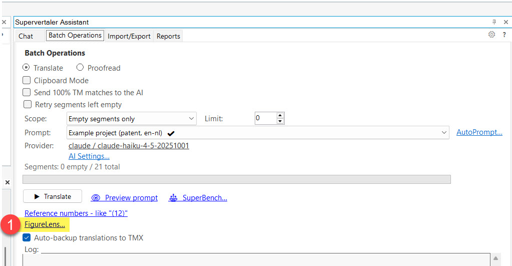
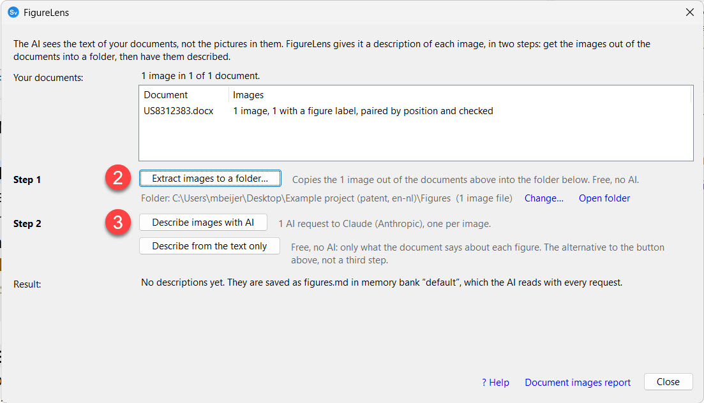
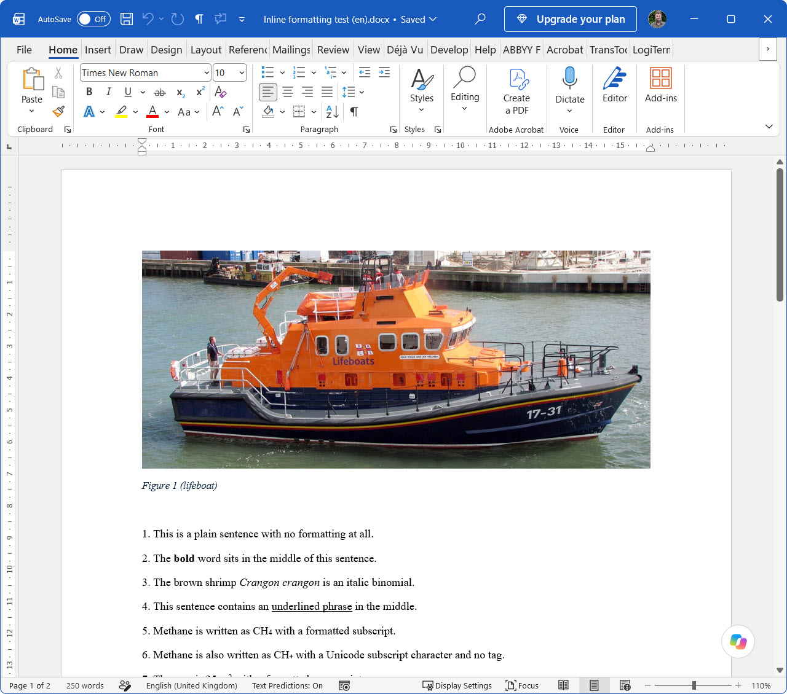
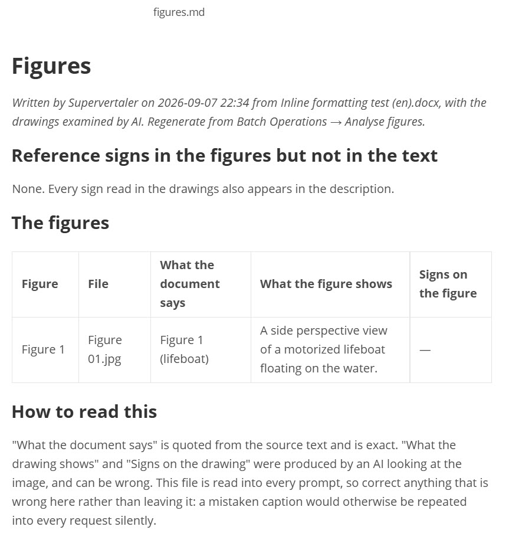

---
title: "Batch Operations"
---

The **Batch Operations** tab in the Supervertaler Assistant panel provides two AI-powered modes for processing multiple segments at once:

| Mode | Description |
|------|-------------|
| **[Batch Translate](/trados/batch-translate/)** | Translate segments using AI with customisable prompts |
| **[AI Proofreader](/trados/ai-proofreader/)** | Check translations for errors, inconsistencies, and style issues |

Switch between modes using the **Mode** dropdown at the top of the Batch Operations tab.

Both modes share the same prompt selector, provider/model configuration, and scope options. Prompts are filtered by mode – Translate prompts appear in Translate mode, Proofread prompts appear in Proofread mode. From v18/19.20.200 each mode starts on its shipped default prompt – the **Default Translation Prompt** or the **Default Proofreading Prompt** – until you choose another; **(Built-in instructions only)** at the top of the list sends Supervertaler's own instructions without a prompt from your Library. You can click the **provider/model label** to quickly switch AI models via a flyout menu – the same menu available in the Chat tab.

### Clipboard Mode

Both Translate and Proofread modes support **[Clipboard Mode](/trados/clipboard-mode/)** – an alternative workflow that lets you use any web-based AI (ChatGPT, Claude, Gemini, etc.) without an API key. Tick the **Clipboard Mode** checkbox to switch from API-based processing to a manual copy/paste workflow. See [Clipboard Mode](/trados/clipboard-mode/) for full details.

### Include full document content in AI context (from v18/19.20.208)

The tick box **Include full document content in AI context** is directly under **Send TM matches to the AI**. When it is ticked, the whole document goes to the AI as context with every request, so the AI can see what kind of document this is and what the rest of it says. A long document is cut down to the number of segments set as **Max segments** in [AI Settings](/trados/settings/ai-settings/#max-segments). It costs more input tokens: untick it to spend less.

* **What follows it:** Batch Translate, Batch Proofread, Translate active segment (`Alt+T`), Clipboard Mode, **👁 Preview prompt** and SuperBench.
* **It is shown in both Translate and Proofread mode**, and it is locked while a run is going.
* **Chat and QuickLauncher have a tick box of their own**, with the same label, on the [Chat tab](/trados/ai-assistant/chat/#include-full-document-content-in-ai-context-from-v181920208). Neither box changes the other.
* **AutoPrompt follows neither**: it always reads the whole source text to write its prompt.

Before v18/19.20.208 there was one tick box for everything, in Settings → AI Settings. It is gone from there. Both new tick boxes start with the value it had, so nothing changes until you untick one of them. What is sent is described under [Include full document content](/trados/settings/ai-settings/#include-full-document-content).

### Preview prompt

Next to the action button, the **👁 Preview prompt** link opens a read-only dialog showing **exactly what would be sent to the AI** for the current configuration: the assembled system prompt (including the active custom prompt, termbase entries, language-specific checks, and the full bilingual document context for proofread), followed by the numbered segment list. No LLM call is made. It shows the prompt exactly as it is sent, with its line breaks, also for a memory-bank file saved with Unix line endings *(from v18/19.20.206; before, such a file appeared as one run-on paragraph, though what was sent was always correct)*.

This is useful for:

* **Sanity-checking before an expensive call** – see what the model will actually receive (including how many tokens of context, whether your termbase is being included, whether the right segments are in scope) before clicking Translate / Proofread.
* **Debugging unexpected output** – if the AI produces an odd suggestion, the preview shows you the exact prompt the model was answering, so you can see whether the issue is in your custom prompt, the termbase, the document context, or the segment list.
* **Manually pasting into a web LLM** – the dialog has its own *Copy to clipboard* button, so you can use it as a one-shot "send this to ChatGPT/Claude/Gemini" path without toggling Clipboard Mode.

The preview works in both **API mode** and **Clipboard Mode** without switching, and is available for both Translate and Proofread.

### SuperBench

Next to Preview prompt, the **⚖ SuperBench…** link (from v18.20.187) translates the first segments of the document with three models under exactly these batch settings and has a judge compare them blind, with a recommendation for this project. Nothing is written to the document. See [SuperBench](/trados/superbench/).

### List numbering as structure context

Word's claim numbers, lettered steps and bullets are not segment text, so the AI used to never see them. Since v18.20.188 (always on from v18.20.189; see [AI Settings](/trados/settings/ai-settings/#list-numbering-as-structure-context-from-v1820188-always-on-from-v1820189)), Batch Translate prefixes the first segment of each numbered paragraph with its marker inside a sentinel – `[#e)]`, `[#9.]` – and tells the model it is structure, never to be reproduced. The log reports how many markers were found, and any marker the model echoes back is removed before the target is written. Preview prompt shows the markers as they will be sent.

### Reference numbers

Technical documents – patents, manuals, specifications – point at parts of a drawing with numbers in brackets: "the valve (12) is connected to the pipe (3a)". The **Reference numbers - like "(12)"** link lists every such number in the open document, how often it is used, and the sentence that first mentions it. It also names any number the sequence skips – a document citing (1) to (4), (6) and (7) is told that (5) is cited nowhere, which usually means a part was renumbered or dropped while the document was drafted. It reads the whole document regardless of the Scope setting, makes no AI call, and opens the list in the Chat tab. A document without such numbers simply says so. Useful for spotting a number that is cited once and never explained, or a part that changes number halfway through.

### FigureLens (from v18.20.189)

The AI sees the text of your documents, not the pictures in them. **FigureLens** fixes that in two steps, and it tells you at each step what will happen and what it costs. The **FigureLens…** link opens it.

<figure><figcaption>Click 1: the <strong>FigureLens…</strong> link, under Batch Operations.</figcaption></figure>

<figure><figcaption>Clicks 2 and 3, in the panel that opens: <strong>Extract images to a folder</strong> (free, no AI), then <strong>Describe images with AI</strong> – one AI request per image. <strong>Describe from the text only</strong> is the free alternative to that second button, not a third step.</figcaption></figure>

<figure style="flex:1 1 300px;margin:0"><figcaption>What is in the document: a picture the AI cannot see.</figcaption></figure>
<figure style="flex:1 1 300px;margin:0"><figcaption>What Step 2 writes: the description the AI reads with every request.</figcaption></figure>

**Your documents** – a summary line and a two-column table of every Word document in the project, name in one column and what was found in it in the other (the source-language files in Studio's Files view; reference files are skipped): how many images each holds and how many carry a figure label, the documents with images first, then those with none in grey, then any that could not be read in red. Nothing outside the project is scanned; if the pictures are in a separate document, add it to the project.

**Step 1 – Extract images to a folder…** The first time, it asks where to put the images; a new, empty folder next to the job is fine, and the choice is remembered for this project. Then it copies the images out of the documents into that folder, named after their figure numbers (`Figure 01.png`, `Figure 02.png`…). If more than one document has images, each gets its own sub-folder inside it, so two documents' `Figure 01` cannot overwrite each other. Drawings held as vector images (EMF or WMF, which is what a drawing placed from CAD usually is) are rendered to PNG on the way out, because no AI can read a metafile. Free, no AI. If you already keep the images in a folder of your own, use **Already have the images in a folder? Choose it…** instead, and later **Change…** to switch folder or **Open folder** to look at them.

**Step 2 – Describe images with AI.** Shows each image to the AI together with what the document says about it, and saves a description of each – what it shows, which figure it is, which parts and numbers appear in it – as `figures.md` in the active memory bank. That file is read by the AI with every request from then on, so it knows what your images mean in this document. Each document gets its own table in the file. One AI request per image; the button says how many and to which provider before you click. It asks before replacing descriptions that already exist. **Describe from the text only** is the free alternative: only what the document itself says about each figure, without looking at the images. Use one or the other.

**Result** – whether the descriptions exist yet, when they were saved, how many figures, and whether they came from the AI or from the text alone.

The descriptions are saved in the active memory bank, and that must be a bank of this project's own: the shared bank is read by every project, so the panel refuses to write there and instead offers **Create memory bank “<project name>” for this project and switch to it**, one click. If you already keep a bank for the project, pick it on the Chat tab first.

Buttons that cannot run yet say why: no images in the documents and none in the chosen folder, step 1 not done, or no active memory bank. The **Document images report** link at the bottom opens the full per-image listing in the Chat tab. **Reference numbers** stays a separate link above, because it is a check on the text, not part of this pipeline.

#### When the drawings came as separate files (from v18.20.207)

The drawings of a patent are often sent as image files beside the text, not as pictures in the Word document. FigureLens can describe those too.

**When this applies.** The project's documents hold no images at all. FigureLens says so under **Your documents**, for example: *No images in the 1 document of this project. The 4 image files in the folder below will be used.* If the documents do hold images, FigureLens works from those, as before, and ignores other files in the folder. It is one or the other, never both.

**Choose the folder.** Under step 1, click **Already have the images in a folder? Choose it…** (later: **Change…**). The step 1 button stays grey, because there is nothing to extract. Then use **Describe images with AI** as usual.

**Which files are used**

- Image files in the folder and in its sub-folders one level down.
- PNG, JPG, GIF and WebP are sent as they are.
- BMP, TIFF, EMF and WMF are converted to PNG first, in memory; your file is not changed. Of a TIFF with several pages, only the first is used, and its row says so.
- PDF, Word and other files are not used, and the folder line says how many there are. To use a drawing that is in a PDF, save its pages as PNG first.

**A file gets its figure number from its name, never from the picture**

| File name | Figure |
| --- | --- |
| `Figure 3.png`, `fig3.jpg`, `FIG-3.png`, `Figuur 3.png`, `03.png` | 3 |
| `PROJ-001 Fig. 3A (amended).png` | 3A: the word and number can be anywhere in the name |
| `Fig 1-2.png`, `Figs 3 and 4.png`, `Figures 5A-5C.png` | One file holding several figures. It is sent once, with the text for each of them. |
| `Figure 1 - 13 Nov.png`, `Figure 3 (2).png` | 1 and 3: a second number counts only where it cannot be anything else |
| `scan0042.png`, `page 2.png` | No figure number. The file is still described, and its row reads *no figure number in the file name*. Rename it (`Figure 2.png`) and run again to give it one. |

**What is sent with each file.** The figure label and every sentence of the text that opens by naming that figure ("Figure 3 shows …", "Fig. 3 is …"). Sentences that mention the figure further on ("In figure 3, …") are not picked up. A letter is ignored when the text is looked up: `Figure 3A.png` gets the sentences for figures 3, 3A and 3B.

**What it costs.** One AI request per image file. Beside the button, the window says before you start how many requests it will make, how many files it matched to a figure, and whether a figure in the text has no file.

- More than 25 files: FigureLens asks first, naming the number and the folder.
- More than 200 files: it refuses, and asks for a folder that holds only this project's drawings.
- It always asks before replacing a `figures.md` that already exists.

**In `figures.md`**

- A line under the heading says that the images came from the folder and that the figure numbers come from the file names.
- Two files that give the same figure are both described, and each names the other.
- A file for a figure the text never describes says so.
- A figure the text describes that has no file is listed with its text and *no image file for this figure*.

**Describe from the text only** needs no images. With none in the documents, it writes one row for each figure the text describes, with the matching file from the folder where there is one. If no sentence in the text opens with a figure label, the button is grey and says so.

#### Stopping a run, and runs that fail (from v18.20.207)

- While a run is on, **Describe images with AI** reads **Stop**. A stopped run saves nothing.
- If no image could be described, for example because of a wrong API key or no network, nothing is saved. A red line in the window gives the reason the provider gave for the first image.
- In both cases, a `figures.md` that was already there is left exactly as it was.
- If only some images fail, the file is written. The failed rows say *not analysed* and why.

#### Limits

- 200 image files per run.
- A file over 50 MB is skipped, and so are an empty file and a file that is not really an image, each with the reason in its row.
- An image larger than about 3.5 MB, or wider or taller than 7,900 pixels, is scaled down before it is sent, to at most 2,200 pixels on its long side. Your file is not changed. A WebP image that large cannot be scaled here: save it as PNG or JPG.

### AutoPrompt

The Batch Operations tab also includes an **[AutoPrompt](/trados/generate-prompt/)** link that uses AI to create a comprehensive, domain-specific translation prompt based on your project's content, terminology, and TM data.

## See Also

* [Clipboard Mode](/trados/clipboard-mode/)
* [SuperBench](/trados/superbench/)
* [AutoPrompt](/trados/generate-prompt/)
* [Prompts](/trados/settings/prompts/)
* [AI Settings](/trados/settings/ai-settings/)
* [Keyboard Shortcuts](/trados/keyboard-shortcuts/)
