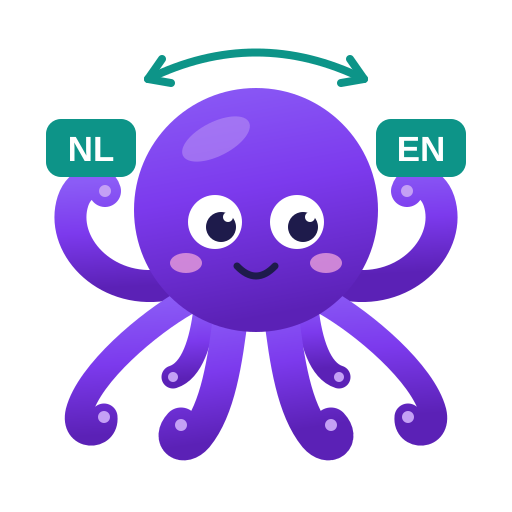

:::caution[Not released yet – coming in 18.20.206]
EverTM is not in any released version of Supervertaler for Trados yet. It comes with version 18.20.206 / 19.20.206. This page describes how it will work, so you can see what is coming; the details may still change before it ships.
:::

EverTM is **one translation memory for every language variant, in both directions**, built into Supervertaler for Trados. You add it to a project like any TM. One Dutch–English memory serves nl-BE > en-US, nl-NL > en-GB, en-GB > nl-BE and en-US > nl-NL alike. There are no reversed copies to make and nothing to add per variant. (Each translation unit still remembers its own variant; see [Keeping language variants apart](#planned) for what is planned for those who want them kept separate.)

You fill it by importing TMX files and Studio TMs, and **it learns from the segments you confirm**. It needs no other program.

Supervertaler remembers in two ways: **SuperMemory** holds what you've *learned* – your notes for the AI about a client or subject – and **EverTM** holds what you've *translated*: every segment pair from your TMs. See [SuperMemory](/trados/ai-assistant/super-memory/) for the notes.

EverTM isn't encrypted or locked storage. It is your own lifetime translation memory: one ordinary database on your own PC, in your Supervertaler data folder (see [Where it lives](#where-it-lives)). Keep it safe as you would your other TMs.

## Why EverTM

With Studio's AnyTM, every reversed or variant copy of a TM piles up: one TM for Dutch to English, another for English to Dutch, more for each language variant. The same translations end up stored many times, in TMs you have to keep apart and keep up to date.

EverTM is one memory that serves every language variant in both directions. There are no copies. Each translation is stored once, with where it came from and when, and it serves every project in that language pair.

:::tip[EverTM compared with a Studio TM]
- **One memory, not one per direction and variant.** A Studio TM has one direction and one pair of variants. EverTM serves nl-BE > en-US and en-GB > nl-NL from the same translation units.
- **Your project name is stamped automatically.** Every segment you confirm is stored with the project's name, its client, the document, your user name and the date, with nothing to set up (see [What is stamped on a segment you confirm](#what-is-stamped-on-a-segment-you-confirm)). A Studio TM stores such a value only if the TM has a field for it and the value is filled in under **Project Settings > Translation Memory and Automated Translation > Update** in every project. Supervertaler can fill in the project's name and client there for you, but that is off until you switch it on, and a Studio TM cannot store the document's name this way (see [Stamping the project's name and client on Studio TMs](/trados/settings/general/#studio-translation-memories)).
- **Nothing to set up per project.** Add EverTM once to your default settings and it is there in every new project, in any language pair.
- **Your own TMs keep their matches.** EverTM never lowers a match from a project TM (see [Your own TMs always come first](#your-own-tms-always-come-first)).
- **One translation per sentence.** When a sentence has been translated in several ways, you get the newest. The older ones are kept, not deleted.
- **Yours to take away.** It is an ordinary database on your own PC, and it exports to a TMX file at any time.

A Studio TM is still the right choice for a TM you share on a server, a TM a client sends you and expects back, and for editing translation units by hand. EverTM works beside those TMs; it does not replace them.
:::

## What you get

- **Matches in Translation Results**, with a match % and the differences from your segment highlighted, as for any TM. EverTM scores a fuzzy match the way Studio does (see [Match percentages](#match-percentages)).
- **Where each match came from.** The project, client, subject and document it was translated for, and who translated it and when (see [What you see in Studio](#what-you-see-in-studio)).
- **One translation per sentence: the newest.** Where EverTM holds several translations of a sentence, you see the most recent one (see [One translation per sentence](#one-translation-per-sentence-the-newest)).
- **Analyze and Pre-translate** count and use EverTM matches like any TM's.
- **AI Batch Translate** sends EverTM's matches to the AI too (see [AI Batch Translate](#ai-batch-translate)).
- **Concordance search** on the source and on the target, with the words you searched for highlighted. Concordance results show the text without its formatting.
- **Formatting comes along.** Where a stored translation unit has the same formatting as your segment, the match carries your document's own tags in the right places. When the tags can't be placed with confidence – the stored translation unit has a different number of tags than your segment, for example – the match comes as plain text, with your project's formatting penalty, just as a Studio TM's would.
- **It learns as you work.** With its **Update** box ticked, every segment you confirm goes into EverTM (see [Learning as you work](#learning-as-you-work)).

## What's coming

EverTM is meant to become the one place for everything you have ever translated: not only a memory that gives matches, but one you can sort, filter and look after. The order and the details below may still change.

### Now in EverTM (from v18/19.20.206)

- **Your TMs' information is kept.** Each translation unit keeps its fields – Project, Client, End client, Subject, Document, Source and Note – and who created and last changed it, and when. This comes from TMX files, Studio TMs and Workbench, and Studio shows it with every EverTM match.
- **The newest translation wins.** When a sentence has been translated in more than one way, EverTM gives the newest translation (in your exact language variant first). Older translations are kept and hidden, never deleted.
- **Re-importing fills in what was missing.** Importing a TM again adds its fields and dates to the translation units EverTM already holds, without storing anything twice.
- **AI Batch Translate uses EverTM.** Its TM matches, which it sends to the AI with each segment, include EverTM's.
- **Export to TMX includes the fields, dates and users.**

### Planned

- **EverTM Matches, a pane of its own in Studio's Editor**, next to TermLens. It shows EverTM's matches with the differences highlighted, and a one-line summary under each match (client, project, date), so you can tell matches apart at a glance. Below them, the selected match's full details: every field, its dates and users, and its older translations. You can remove a wrong translation from EverTM there, with Undo and a list to restore it from. It can take the place of Studio's Translation Results for EverTM.
- **A manager for EverTM.** Browse what EverTM holds by client, end client, project, subject or where it came from, with the number of translation units in each. Export just the part you need – all patent work for one client, say – to a TMX file.
- **A profile per project.** Tell EverTM what a project is – its client and subject – and it tags the translations you confirm with them. The same profile limits EverTM's matches to work that fits: patents only, for example, or never medical texts. It applies everywhere EverTM is used – Translation Results, Analyze, Pre-translate, Batch Translate and EverTM Matches. Translation units without any information always pass, and a switch shows the matches that were left out. Projects made from the same Studio template share a profile.
- **Keeping language variants apart, if you want to.** Each translation unit remembers the language variant it came with (nl-BE, en-GB and so on), but EverTM mixes the variants when it looks for matches: one memory serves them all. That suits translators who adapt UK or US spelling at the end anyway. For those who would rather keep variants apart, as with separate Studio TMs, a **Language variants** setting will offer three choices: mix them (as now, and the default), mark matches from another variant down by a penalty you choose (an en-US match showing 98% in an en-GB project, say), or offer only matches in the project's exact variant. It can be set per project.
- **Re-tagging in bulk**, for translation units that came in without information.
- **Context matches**, where the previous segment matches too.
- **Cleaning up and editing:** finding near-duplicates, and correcting a translation unit or its information.

## Your own TMs always come first

EverTM never lowers a match from your project TMs.

This matters because of how Studio treats two TMs that disagree. When two TMs give different 100% translations for a segment, Studio marks *every* 100% match down to 99% (its **multiple translations** penalty), including the one from the TM you trust. EverTM avoids that: its matches always rank after another TM's match of the same score.

- Where only EverTM has the segment, its match shows as 100%.
- Where your TM has a 100% or Context Match, that match stays exactly as it was, is listed first, and is the one Pre-translate uses. EverTM's match is listed after it.
- If EverTM holds the very same translation unit as your TM – the same source sentence and the same translation – Studio shows the two as one row, not two. When they score the same, as they normally do, it is your TM's row. Where EverTM scores a point or two higher, it is EverTM's row, with the same translation. A translation unit that differs only in its formatting (other tags) is a different one to Studio, and is shown twice.
- If two of *your* TMs disagree, Studio penalises them as it always has.
- EverTM on its own never gives two different 100% matches for a segment, because it offers one translation per sentence (see [One translation per sentence](#one-translation-per-sentence-the-newest)). So it never triggers Studio's multiple translations penalty by itself.

## Match percentages

EverTM scores a fuzzy match the way Studio scores one from its own TMs. An EverTM match and a Studio TM match for the same sentence normally show the same percentage, and Analyze puts them in the same band.

- **What counts, as in Studio.** A missing or extra word counts more than a missing comma. A word in another form ("disable" and "disabling"), with another capital letter or without its accent counts as a small change. A word that has moved counts as one change. The differences are weighed against both sentences.
- **Close to Studio's figure, not always the same.** Studio's own word lists, and its way of reading measurements and web addresses, are not public. For most sentences EverTM gives Studio's percentage or one within 2 points of it. About one match in ten scores a point or a few higher in EverTM (typically 1 to 3 points, mostly between 50% and 80%). Lines that are mostly numbers can be lower.
- **13 languages.** Word forms and common words ("the", "of") are recognised for Danish, Dutch, English, Finnish, French, German, Hungarian, Italian, Norwegian, Portuguese, Russian, Spanish and Swedish. In other languages a word in another form counts as a different word, so a match can be a few points lower than in Studio.
- **100% means the identical sentence**, and nothing else.
- **The differences are highlighted as for a Studio TM.** Extra, missing and changed words are marked where Studio marks them for its own TMs. Where a whole stretch was reworded, EverTM shows the new words and then the old ones, struck through, so an EverTM row and a Studio TM row may mark that stretch differently. The percentage is the same.
- **Very long segments** (over about 200 words) get a percentage but show no differences.

### When only a number differs

Your segment says "claim 9" and EverTM holds the same sentence with "claim 8". EverTM puts your number into its proposal, as Studio does with its own TMs, and does not count the number as a difference. The match shows **99%**, never 100%: in EverTM, 100% always means the identical sentence, so a match whose number was changed for you is never taken for an exact one.

A number in the wrong place is a real error, so EverTM replaces a number only when it cannot go wrong: the same numbers in the same order in your segment, in the stored sentence and in its translation, each changed number occurring only once, and written the same way. Otherwise it leaves the proposal as it is and marks the numbers as differences. That happens when:

- a number occurs twice in the sentence;
- numbers have changed places;
- a number is written differently – a date in another order, a decimal comma against a decimal point;
- there is one number more or fewer.

Studio replaces numbers more freely, so in those cases Studio's own TM may show a higher percentage than EverTM for the same sentence.

"M8", "2nd" and the like count as words, not numbers.

:::note
**Pre-translate** set to apply 100% matches only does not fill in these 99% segments. Set its minimum to 99% or lower if you want them filled.
:::

## Setting it up

1. Open **Project Settings** (or **File > Options** for your default settings), go to **Language Pairs > All Language Pairs > Translation Memory and Automated Translation**, and click **Use > EverTM...**. You can add it to a project in any language pair, also one it holds nothing for yet.
2. Fill EverTM: click **Import TMX...**, **Import Studio TM...** or **Import from Workbench** (see [Importing](#importing)). The import runs in the background, so you can click **Add** and keep working; Studio starts using the new translation units as soon as EverTM has updated its search index. You can also start empty and let EverTM fill up as you work.
3. Tick **Lookup** and **Concordance** for EverTM in the list, as for any TM, and tick **Update** if you want it to learn from the segments you confirm. When you add EverTM, Studio ticks Update for you only if no other TM in the project has Update ticked.

To import more later, see what EverTM holds, or rebuild its index, select EverTM in the list and click **Settings...**.

### EverTM's window

EverTM's window (**Settings...**) opens with a short description: EverTM is one translation memory for all your work, so your Dutch–English translations also help in English–Dutch projects, and en-GB translations show up in en-US projects. Below that, it shows what EverTM holds, for example:

- **Translation units: 871,290** – how many EverTM holds.
- **Metadata: 285 projects, 55 clients, 15 subjects** – shown once EverTM has any (see [What EverTM keeps](#what-evertm-keeps)).
- **Indexed translation units: 871,290, built …** – what its search index covers, and when it was built.
- **Since Studio started, 12 confirmed: 9 added, 2 replaced, 1 already in EverTM** – what it did with the segments you confirmed, and how many are waiting to be stored, if any.
- **Stamped on segments you confirm:** – a tick box each for Project, Client, End client, Subject, Document and User, all ticked to start with (see [What is stamped on a segment you confirm](#what-is-stamped-on-a-segment-you-confirm)).
- **Indexing: 190,000 of 871,290 translation units. You can close this window and keep working.** – while EverTM is building its index. An import or export shows its own progress here in the same way (*Importing …*, *Exporting …*).
- **Last task:** – what the last import, export or rebuild did, once it has finished.

## Learning as you work

With EverTM's **Update** box ticked in the project's TM settings, every segment you confirm is added to EverTM, and so is a batch **Update Main Translation Memories**. Your project TMs are updated as usual: EverTM learns alongside them.

- **Found at once.** A segment you confirm is offered straight away, as an exact match, when the same sentence comes up again in that Studio. As a fuzzy match it can take a moment to show on the very next segments, because Studio looks those up ahead of time, before EverTM has indexed the new segment; reopening the document shows it. Another Studio finds the segment within a few seconds. Nothing is rebuilt.
- **Stored like an import:** once per language pair, whatever its direction and variants, with its formatting.
- **With where and when.** Each segment you confirm is stored with your Studio project's name and client, the document's name, your user name and the time you confirmed it. You can switch each of these off, except the time (see [What is stamped on a segment you confirm](#what-is-stamped-on-a-segment-you-confirm)).
- **Correcting replaces.** Change a segment's translation and confirm it again, and EverTM replaces what it learned from that segment rather than adding a second translation.
- **Imported translation units are never changed.** If you confirm a different translation of a sentence you imported, EverTM keeps both. Yours is the newest, so it is the one EverTM offers from then on.
- **Confirming is never slowed down.** EverTM does its work in the background. If it can't store something – a full disk, a drive that isn't there – its window says so and it tries again; your confirmation in Studio is unaffected.
- **Several Studios at once.** You can run Studio 2022, 2024 and 2026 side by side on one EverTM. While one Studio imports or rebuilds the index, segments confirmed in the others wait safely and are stored as soon as it has finished, also if you close that Studio in the meantime.

Install the same version in every Studio you use with EverTM: an older version still finds the translation units, but doesn't see newly learned ones until its index is rebuilt.

## Importing

| Import | What it takes |
| --- | --- |
| **Import TMX...** | Any TMX file, of any size. A translation unit in more than two languages gives one translation unit per pair of languages. Formatting tags are kept. |
| **Import Studio TM...** | A Studio file-based TM (`.sdltm`), read through Studio itself, formatting tags included. A TM with a password can't be imported: export it to TMX in Studio and import that. |
| **Import from Workbench** | Shown only if you have Supervertaler Workbench. First lists Workbench's TMs, each with its language pairs and number of translation units: tick the ones you want (**Select all** / **Select none**) and click **Import**. EverTM remembers the TMs you left unticked; a TM added to Workbench later starts ticked. Workbench's database is only read, never changed. |

- **Nothing is stored twice.** If EverTM already has a translation unit with the same text and formatting, an import doesn't add it again. That holds in either direction, for any variant of the two languages, and however the tags are numbered. So importing the same TM twice, or an en-GB > nl-NL TM after its nl-BE > en-US twin, adds no new translation units. Whatever the second import does bring – a project, a client, a date – is added to the translation units already there (see [Translation units imported before this version](#translation-units-imported-before-this-version)).
- **The summary** after an import says what happened, for example *"52,113 translation units read: 0 new, all others already in EverTM (6,201 of them brought metadata or dates)"*, or *"52,113 translation units read: 1,204 new, 50,905 already in EverTM; 4 skipped (no text, one language, or junk)"*. The counts are of translation units *read*: a translation unit that is in two of the TMs you import is read twice, so "already in EverTM" can be larger than what EverTM holds.
- **Skipped:** translation units with no text once the tags are removed, translation units with the same language on both sides, and a known kind of broken translation unit from public software corpora, where a menu label ran into the next one (*AndereSearch in:" "All Categories*).
- **An import that fails or that you stop adds nothing**: the memory and the index stay as they were.
- Variants count as one language (nl-BE and nl-NL are both Dutch); different scripts don't (Chinese Simplified and Traditional, Serbian Latin and Cyrillic are kept apart).

## Exporting

To take your memory elsewhere – another CAT tool, a colleague, a backup you can read – select EverTM in the project's TM list, click **Settings...** and then **Export TMX...**.

- **Choose what to export.** The window lists what EverTM holds by where it came from (each TMX or TM file, "workbench", "studio" for segments you confirmed), with the number of translation units. Choose a language pair or **All language pairs**, tick the sources you want (**Select all** / **Select none**), click **Export...** and pick where to save the TMX file.
- **What the file holds.** A standard TMX 1.4 file. Each translation unit is written in the direction and language variants it was first stored with, with its formatting tags, its fields (Project, Client, Subject and so on), when it was created and changed and by whom (where EverTM knows), the date it went into EverTM, and where it came from. Older translations that EverTM hides in Studio are exported too.
- **Back in, unchanged.** Import the file into EverTM again – on another PC, say – and you get exactly the same translation units back, with their formatting, dates and fields.
- **Keep working.** The export runs in the background; you can go on translating, in that Studio and in others. With 10 million translation units it takes about 4 minutes and gives a 3.5 GB file.
- **Stop leaves nothing.** Click **Stop** and the half-written file is removed: you never end up with a partial TMX.

## What EverTM keeps

For each translation unit, EverTM keeps the source and target text with their formatting, the language pair it first came with (nl-BE > en-US, say), and when it went into EverTM. With that, it keeps this information about the translation – its *metadata*:

| Field | What it holds |
| --- | --- |
| **Project** | The project it was translated for. |
| **Client** | The client. |
| **End client** | The client's own client, when you work through an agency. |
| **Subject** | The subject field. A TM's "Domain" (memoQ, DéjàVu) counts as Subject. |
| **Document** | The document it was translated in. |
| **Source** | Where EverTM got it: the TMX file, the Studio TM or the Workbench TM, or *Studio: PROJ-001* for a segment you confirmed in that project. |
| **Note** | A note stored with it. |

A field can hold several values: a sentence that was in two projects keeps both names. EverTM keeps at most 20 values per field, so a very common sentence ("Figure 1") doesn't collect hundreds.

EverTM also keeps **when a translation unit was created and last changed, and by whom**. In an agency TM, other translators' and reviewers' names are kept too. If EverTM doesn't know who made or changed a translation unit, it leaves the user empty.

It does **not** keep other fields (PO numbers, Studio's technical fields), usage counts, or Workbench's own dates (they say when a translation unit entered Workbench, not when it was translated).

### Where the metadata comes from

- **TMX files:** these fields, whatever the tool that made the file calls them (CafeTran, memoQ, Studio, DéjàVu and others). The dates come from the translation unit, or from the file's header when the translation unit has none.
- **Studio TMs:** the TM's own fields of those names, and its creation and change dates and users.
- **Workbench:** each TM's name, as Source. A TM name such as `ACME_Globex` – the client in capitals, an underscore, then the end client – is also split into Client "ACME" and End client "Globex". Only names in exactly that form are split, and the import summary says how many were.
- **Segments you confirm:** see [What is stamped on a segment you confirm](#what-is-stamped-on-a-segment-you-confirm).

### What is stamped on a segment you confirm

EverTM stamps every segment you confirm with where it was translated and by whom. There is nothing to set up, and no field to add first.

| Stamp | What EverTM stores |
| --- | --- |
| **Project** | Your Studio project's name. |
| **Client** | The project's customer in Studio. |
| **End client** | The client's own client. |
| **Subject** | A Subject set in the project's TM update fields (**Project Settings > Translation Memory and Automated Translation > Update**). |
| **Document** | The document's name. |
| **User** | Your user name. |

Each has a tick box in [EverTM's window](#evertms-window), after **Stamped on segments you confirm:**. All six are ticked to start with.

- **Unticking one** stops EverTM storing it from then on. Translation units already in EverTM keep what they have.
- **With Project unticked**, the Source field says only *Studio*, without the project's name, so the name is not stored anywhere.
- **The time you confirmed a segment is always stored.** It has no tick box, because it decides which translation is the newest.

These tick boxes are for EverTM only. To have the project's name and client stored in your Studio TMs too, see [Stamping the project's name and client on Studio TMs](/trados/settings/general/#studio-translation-memories).

### One translation per sentence: the newest

When EverTM holds several translations of the same source sentence, a lookup offers only one: the **newest**, by when it was translated or last confirmed – never by when you imported it.

- **Your language variant first.** In an en-GB project, an en-GB translation wins, even an older one. Only when there is none in en-GB does the newest in another variant show.
- **No date counts as oldest.** A translation without a date counts as older than any dated one. Among undated ones, the one imported last wins.
- **Confirming makes it the newest**, also a translation you imported or an older one.
- **Older translations are hidden, never deleted.** Each one still serves the other direction, where it may be the only translation. Nothing is lost, and an export writes them all.
- A confirmation that reaches EverTM late, from another Studio, never overrides a newer one.
- Fuzzy matches and Concordance show one translation per source sentence too.

### Translation units imported before this version

Translation units you imported with an earlier test build have no metadata or dates yet, so to EverTM they all count as equally old. **Import the same TMX files, Studio TMs and Workbench TMs again.** Nothing is added twice. Instead, EverTM fills in the metadata and dates on the translation units already there:

- **Fields are combined.** The values the import brings are added to the ones a translation unit already has, up to 20 per field.
- **Dates are combined.** The earliest created date and the latest changed date are kept.

The import summary says how many translation units brought metadata or dates. A large re-import – more than a quarter of what EverTM holds – rebuilds the index afterwards.

### What you see in Studio

- **Translation Results and Concordance** show the fields on each EverTM match, with Project, Client and Subject first. Studio shows the first few beside the match, one under the other. The column is narrow, so long values are cut off ("…"): hover over them to see the full list. If EverTM hid older translations of the sentence, the list ends with *Older translations: N*.
- **Below the results**, Studio shows when the translation unit was created and last changed, and by whom, as for its own TMs. A translation unit with no known date shows when it went into EverTM. When EverTM doesn't know the user, no user is shown; Studio's tooltip over that line then says "Never" and "N/A", as it does for any TM's translation unit without a user.

Client and project names, and other people's user names from agency TMs, are stored only on your PC, in the EverTM folder. But they show in Translation Results and Concordance – so also in screenshots and screen shares – and an EverTM TMX export includes them.

## AI Batch Translate

With **Send TM matches to the AI** on, [AI Batch Translate](/trados/batch-translate/) also searches EverTM for each segment's best match, when EverTM is in the project's TM settings with **Lookup** ticked. Before, it searched only the project's Studio TMs.

- EverTM's best match at or above your **Lowest TM match to send** takes part like any TM's, with its own source sentence, so the AI sees what differs.
- A project TM's match of the same score wins, and an exact match Studio already put on a segment is never replaced by a lower one.
- EverTM is searched before the first request to the AI: 20,000 segments take about 4 minutes in Studio 2026 and 2 minutes in Studio 2024, with 871,000 translation units in EverTM.
- If EverTM can't be searched – empty, damaged or being rebuilt – the batch goes on with your other TMs.
- Where EverTM has put your segment's number into its translation (see [When only a number differs](#when-only-a-number-differs)), the match says so, and it is sent as *same sentence, different numbers*, not as a 100% match.

## Where it lives

Everything is in `evertm` in your [Supervertaler data folder](/trados/data-folder/):

| What | File |
| --- | --- |
| The memory itself | `evertm.db` |
| Its search index | the `gen-…` folder |
| Confirmed segments waiting to be stored | `inbox.db` (usually empty) |
| The Workbench TMs you left unticked | `workbench-unticked.txt` |

The index can always be rebuilt from the memory, so it needs no backing up. Back up `evertm.db` with the rest of your data folder.

EverTM was called SuperVault in early test builds. If you used one, the first Studio you start with this version renames the `supervault` folder to `evertm` for you, and projects that had SuperVault keep working. Install the new version in every Studio you use before you start any of them.

## Keeping the index healthy

Segments you confirm and small imports are added to the index in place, in seconds. A large import – more than a quarter of what EverTM already holds – rebuilds the whole index instead: about 6 minutes and 365 MB for 1.5 million translation units. Studio keeps using the previous index while the new one is built, and switches over when it is complete.

After you update from an earlier test build, the first Studio you start rebuilds EverTM's index in the background, in a new format: about 6 minutes with 1.5 million translation units. Matches go on meanwhile, from the old index. Install the new version in every Studio you use with EverTM: an older version can't read the new index.

If the index is damaged, or was built by another version of Supervertaler, Studio shows EverTM as unavailable, with a message; your other TMs work as usual. Click **Rebuild index** in EverTM's settings to put it right. An empty EverTM is not an error: it gives no matches and fills up as you import or confirm.

## Speed

A lookup takes about 20 ms in Studio 2024 and 35 ms in Studio 2026 with 1.5 million translation units. Analyze and Pre-translate look up every segment this way. Confirming a segment adds no noticeable delay, and a batch of 20,000 segments is stored in about 20 seconds.

**Size limit in Studio 2024.** Studio 2024 is a 32-bit program, with less memory to work in. There, EverTM refuses an import or index rebuild that would take it past 10 million translation units: it says so and changes nothing. Segments you confirm are never refused, lookups and export work at any size, and Studio 2026 imports beyond that.
