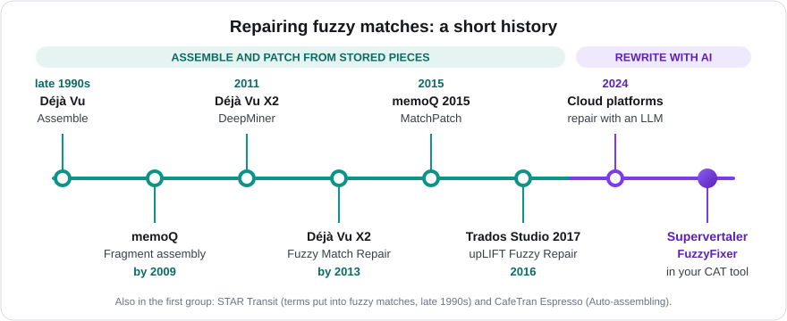

:::caution[Planned – not built yet]
FuzzyFixer is not in any released version of Supervertaler for Trados. It exists in Supervertaler Workbench, and is being planned for the Trados plugin. This page describes what it is meant to do, so you can see what is coming; the details may still change.
:::

FuzzyFixer **repairs a fuzzy match with AI**. When your translation memory holds a sentence that is close to the one you are translating, but not the same, FuzzyFixer takes the old translation and changes only what the difference requires.

It is a single command for the segment you are working on: a right-click menu item in the Editor, with a keyboard shortcut.

## What it does

1. It takes the best fuzzy match for the active segment, from any translation memory in your project. That includes [EverTM](/trados/evertm/).
2. It gives the AI three things: your new source sentence, the sentence the match was made for, and the match's translation. The termbase terms that occur in your segment go along, as they do for every AI translation.
3. The AI rewrites only what the difference between the two source sentences requires. The rest of the old translation stays as it was.
4. You see what was changed, and the result goes into the target as a draft. You review and confirm it, as with any translation.

## How it differs from Studio's Match Repair

Trados Studio has its own match repair (upLIFT Match Repair, the wrench icon in Translation Results). It works mechanically: it puts words and phrases from your termbase, from pieces of your translation memories or from machine translation into the old translation. It does not rewrite the sentence around them.

That works well when one word or number changes. It works less well when the change affects the structure of the sentence, because the inserted piece has to fit the grammar around it.

FuzzyFixer reads both sentences. Because the AI rewrites the affected part, word order and grammar can follow the change.

| | Studio's Match Repair | FuzzyFixer |
| --- | --- | --- |
| How it repairs | Puts in stored terms and fragments | Rewrites the part that changed |
| What it uses | Termbase, TM fragments, machine translation | An AI model, with your terms |
| Cost | None | One AI request per repair |

Both leave the decision to you: a repaired match is a suggestion to check, not a finished translation.

## A long line of match repair

Repairing a near-match by machine is one of the oldest ideas in translation tools.

- **Déjà Vu** had **Assemble** in the late 1990s: with no match for a sentence, it put a translation together from smaller pieces it knew. **DeepMiner** (Déjà Vu X2, 2011) mined the translation memory for those pieces, and Déjà Vu X2 was repairing fuzzy matches with them by 2013.
- **STAR Transit** was putting glossary terms into fuzzy matches in the late 1990s as well.
- **memoQ** had **fragment assembly** by 2009, and added **MatchPatch** in memoQ 2015: it patches a fuzzy match by swapping the part that differs for a term base hit.
- **CafeTran Espresso** has **Auto-assembling**, which builds a draft from matching terms and fragments.
- **Trados Studio 2017** (released in 2016) brought **upLIFT**: Fragment Recall, and Fuzzy Repair from the termbase, TM fragments or machine translation.

All of these work the same way: they find stored pieces and put them in. From 2024, cloud translation platforms began to repair fuzzy matches with a language model instead (Smartling announced it that year). FuzzyFixer does that inside your own CAT tool, with the AI model you chose yourself.

Sources: [Atril's version history](https://atril.com/version-history/) and [key features](https://atril.com/key-features/); [Michael Benis's review of translation memory tools](https://jakobson.korpus.cz/~rosen/VYUKA/MT/tm-review01.htm) (c. 1998–99); [memoQ on memoQ 2015](https://www.memoq.com/pressroom/memoq-2015-and-sdl-trados-studio-2015/) and its [fragment assembly settings](https://docs.memoq.com/current/en/Workspace/fragment-assembly-settings.html); [Paul Filkin on upLIFT](https://multifarious.filkin.com/2016/11/17/more-power-to-the-elbow-uplift); [Smartling's announcement](https://www.smartling.com/company-news/smartling-announces-the-launch-of-ai-translation-toolkit) (2024).

## What it needs

- An AI provider set up in Supervertaler, as for [Batch Translate](/trados/batch-translate/). FuzzyFixer uses the model you chose for translation.
- A fuzzy match for the segment. With no match, or only a 100% match, there is nothing to repair, and FuzzyFixer says so.

## Good to know

- **One request per repair.** FuzzyFixer sends one segment to the AI each time you use it. See the [AI cost guide](/trados/ai-cost-guide/).
- **It never confirms for you.** The result is a draft.
- **Your tags are kept.** The repaired translation goes through the same tag handling as Supervertaler's other AI translations.
