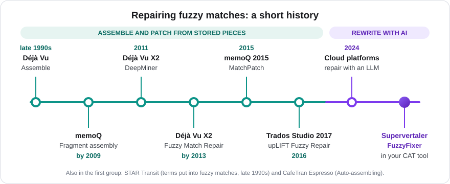

*From v18/19.20.208.*

FuzzyFixer **repairs a fuzzy match with AI**. When your translation memory holds a sentence that is close to the one you are translating, but not the same, FuzzyFixer takes the old translation and changes only what the difference requires.

It is a single command for the segment you are working on: **Ctrl+Alt+F** in the Editor, or right-click in the Editor and choose **FuzzyFixer: repair fuzzy match with AI**.

## How to use it

1. Put the cursor in a segment that has a fuzzy match in one of your project's translation memories.
2. Press **Ctrl+Alt+F**, or **Alt+Q** and then **F** (from v18/19.20.209). A window opens at once and says what it is doing: first it looks for the best match, then it asks the AI. While the window is open, the Editor waits.
3. The window shows the repair as **changes to the match's translation**: removed words are red and struck through, added words are green and underlined. Its top line names the match and the model that repaired it, for example *96% match from Acme EN-NL, repaired by Claude Haiku 5.5* (from v18/19.20.209).
4. Press **Enter** (or **Alt+W**, or click **Write to target**) to write the repair into the target, as a **draft**. Press **Escape** (or **Alt+D**, or click **Discard**) to throw it away. Nothing is written before you press Enter.
5. Review and confirm the segment as usual. **Ctrl+Z** undoes the write.

An example: the memory holds *"The supplier shall attach two labels showing the order number to each box."* for a source sentence about two labels (a 93% match). The new source sentence speaks of one label. FuzzyFixer shows "two" and "labels" struck through, "a" and "label" added, and leaves the rest of the sentence alone.

With voice commands on, say **"repair match"** (or "fix match"). Like every Supervertaler shortcut, Ctrl+Alt+F can be changed in Trados Studio under **File > Options > Keyboard Shortcuts**.

## What it does

1. It takes the **best match below 100%** from the translation memories your project looks things up in: the ones that are switched on and have **Lookup** ticked under **Project Settings > Language Pairs > Translation Memory and Automated Translation**. That covers file-based memories, server memories and [EverTM](/trados/evertm/). FuzzyFixer searches these memories itself; it does not depend on what is selected in Translation Results.
2. It gives the AI three things: your new source sentence, the sentence the match was made for, and the match's translation.
3. The AI changes only what the difference between the two source sentences requires, plus whatever the sentence then needs to stay grammatical (agreement, word order, articles). The rest of the old translation stays as it was.
4. You see what was changed, and decide whether it goes into the target.

A 99% match that differs from your segment only in its numbers counts as a fuzzy match, and is repaired.

### What else the AI gets

- The same as **Translate active segment** (Alt+T): your translation prompt, the termbase terms that occur in the segment, and your [memory bank](/trados/ai-assistant/super-memory/).
- The **three segments before and the three after** your segment, each with its current translation if it has one, so that the repaired words agree with the sentences beside them.

FuzzyFixer **never sends the whole document**, whatever **Include full document content in AI context** says on the Batch Operations tab. That keeps a repair small and cheap.

### With Track Changes on

A repair written over text that is already in the target (the fuzzy match you applied, for example) is recorded word by word: only the repaired words are marked as tracked changes, not the whole segment. See [Batch Translate: With Track Changes on](/trados/batch-translate/).

## When nothing is written

The window says why, and the target stays as it was:

- **No match.** No memory has a match at or above the lowest score (see *Settings* below).
- **The best match is 100%.** There is nothing to repair; apply the match from Translation Results.
- **No memory to search.** The project has no translation memory, or all of them are switched off or have Lookup unticked.
- **No AI set up.** There is no AI provider or API key.
- **The AI returned an error**, or nothing usable. The window shows the AI's own message.
- **The AI returned the match unchanged.** It found nothing to repair. This also happens when the memory has already put your segment's numbers into its translation.
- **The tags don't match.** The repair must carry exactly your segment's tags; one with missing, extra or different tags is not written.
- **The segment is locked**, or a batch translation is running.
- **You closed the window.** That also cancels the AI request.

A segment that is already **confirmed** is not refused: the window says it is confirmed, and Enter replaces its translation and makes it a draft again.

## How it differs from Studio's Match Repair

Trados Studio has its own match repair (upLIFT Match Repair, the wrench icon in Translation Results). It works mechanically: it puts words and phrases from your termbase, from pieces of your translation memories or from machine translation into the old translation. It does not rewrite the sentence around them.

That works well when one word or number changes. It works less well when the change affects the structure of the sentence, because the inserted piece has to fit the grammar around it.

FuzzyFixer reads both sentences. Because the AI rewrites the affected part, word order and grammar can follow the change.

| | Studio's Match Repair | FuzzyFixer |
| --- | --- | --- |
| How it repairs | Puts in stored terms and fragments | Rewrites the part that changed |
| What it uses | Termbase, TM fragments, machine translation | An AI model, with your terms |
| Cost | None | One AI request per repair |

Both leave the decision to you: a repaired match is a suggestion to check, not a finished translation.

## A long line of match repair

Repairing a near-match by machine is one of the oldest ideas in translation tools.

- **Déjà Vu** had **Assemble** in the late 1990s: with no match for a sentence, it put a translation together from smaller pieces it knew. **DeepMiner** (Déjà Vu X2, 2011) mined the translation memory for those pieces, and Déjà Vu X2 was repairing fuzzy matches with them by 2013.
- **STAR Transit** was putting glossary terms into fuzzy matches in the late 1990s as well.
- **memoQ** had **fragment assembly** by 2009, and added **MatchPatch** in memoQ 2015: it patches a fuzzy match by swapping the part that differs for a term base hit.
- **CafeTran Espresso** has **Auto-assembling**, which builds a draft from matching terms and fragments.
- **Trados Studio 2017** (released in 2016) brought **upLIFT**: Fragment Recall, and Fuzzy Repair from the termbase, TM fragments or machine translation.

All of these work the same way: they find stored pieces and put them in. From 2024, cloud translation platforms began to repair fuzzy matches with a language model instead (Smartling announced it that year). FuzzyFixer does that inside your own CAT tool, with the AI model you chose yourself.

Sources: [Atril's version history](https://atril.com/version-history/) and [key features](https://atril.com/key-features/); [Michael Benis's review of translation memory tools](https://jakobson.korpus.cz/~rosen/VYUKA/MT/tm-review01.htm) (c. 1998–99); [memoQ on memoQ 2015](https://www.memoq.com/pressroom/memoq-2015-and-sdl-trados-studio-2015/) and its [fragment assembly settings](https://docs.memoq.com/current/en/Workspace/fragment-assembly-settings.html); [Paul Filkin on upLIFT](https://multifarious.filkin.com/2016/11/17/more-power-to-the-elbow-uplift); [Smartling's announcement](https://www.smartling.com/company-news/smartling-announces-the-launch-of-ai-translation-toolkit) (2024).

## Settings

FuzzyFixer has no settings of its own.

- **The lowest match it repairs** is **Lowest TM match to send (%)** under [Settings > AI Settings](/trados/settings/ai-settings/): 70 unless you changed it. FuzzyFixer works whether or not **Send TM matches to the AI** is ticked for Batch Translate.
- **The AI model** is the one in the **Light tasks** list under [Settings > AI Settings](/trados/settings/ai-settings/#a-model-per-kind-of-task-from-v181920209) (from v18/19.20.209). That list starts on Follow Translation, so until you choose another model it is the one you translate with, local models included. Before v18/19.20.209 it was always the translation model.
- **A licence** is needed, as for the other AI features.

## Good to know

- **One request per repair.** FuzzyFixer sends one segment to the AI each time you use it, and the request is smaller than an Alt+T request that sends the document. On the [Reports](/trados/reports/) tab and in your usage figures, a repair is listed as *FuzzyFixer* (from v18/19.20.209); before that it was listed as *Translate active segment*. See the [AI cost guide](/trados/ai-cost-guide/).
- **It never confirms for you.** The result is a draft.
- **Your tags are kept.** The match comes out of the memory as plain text, so the AI places your segment's tags in the repair, as it does when translating.
- **The match percentage can differ slightly** from the one in Translation Results. FuzzyFixer shows the memory's own score; Studio applies your penalties on top.
- **One segment at a time.** There is no "repair all fuzzy matches" yet.
- **It starts from the match as the memory holds it**, not from Studio's own repaired proposal.
