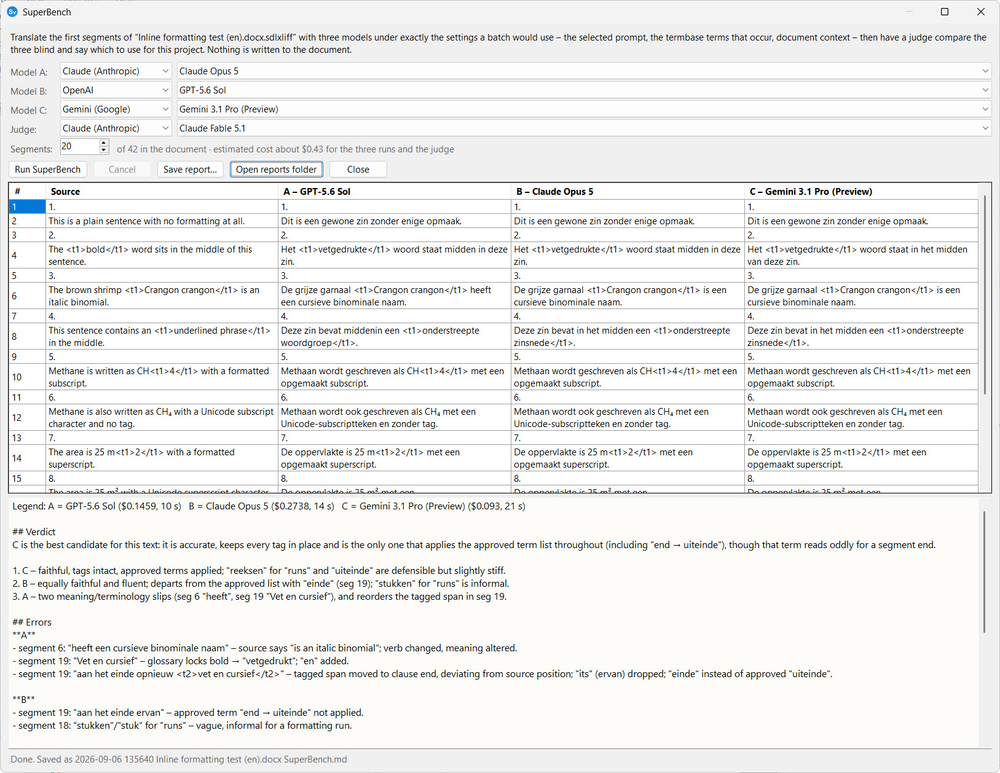

Which model should you use for this project? SuperBench answers that with evidence from the document in front of you rather than from a benchmark of somebody else's text. Available from v18.20.187.

## What it does

1. You pick **three models**, one per slot – any provider each. The defaults are Claude Opus 5.5, GPT-6.1 Sol and Gemini 4 Argon (GPT-6.1 Sol from v18/19.20.199, Gemini 4 Argon from v18/19.20.203; Gemini 3.1 Pro before that).
2. You pick a **judge** – Claude Fable 5.1 by default – and how many segments of the open document to use. Twenty is a good start.
3. Each model translates those segments through the batch pipeline itself. The selected prompt, the termbase terms that occur in the text, the document context, SuperMemory and the batch size are exactly what a real Batch Translate would send; only the model changes. **Nothing is written to the document.**
4. The judge reads the source and the three translations **blind** – labelled A, B and C in a shuffled order, so no brand name colours the verdict – together with the same approved terms and instructions, and writes a short report: a ranked verdict, the significant errors per candidate with segment numbers, how each handled terminology and tags, and a recommendation for this project.
5. The translations appear side by side above the report, with each model's cost and time. The whole thing is saved as Markdown in `trados\reports` inside your data folder, and **Save report…** writes a copy wherever you like.

<figure><figcaption>A finished run on the inline-formatting test document: Claude Opus 5, GPT-5.6 Sol and Gemini 3.1 Pro side by side, judged by Claude Fable 5.1. The legend above the report maps the judge's letters to the models.</figcaption></figure>

## Running it

1. Open the document and set up the Batch Operations tab as you would for a real run: the prompt, and the termbases ticked for AI on the Termbases tab.
2. Click **⚖ SuperBench…** next to **Preview prompt**.
3. Choose the three models, the judge and the number of segments. The line under the segment count shows the estimated cost of the three runs and the judge's call.
4. Click **Run SuperBench**. The status line follows the runs; **Cancel** stops after the current call.

## Reading the report

The legend at the top of the report maps the judge's letters to the models. The judge's own text uses only the letters.

- **Verdict** – the best candidate for this text, and a ranked list.
- **Errors** – the significant errors per candidate, each with the segment number and the words in question. "None found" means the judge looked and found nothing.
- **Terminology** and **Tags** – whether the approved terms were used and the inline tags kept.
- **Recommendation** – which to use for this project, and whether the difference is worth paying for.

A judge is a model too. Treat the report as a well-informed second opinion: read the segments it names before deciding, and run it again on a different stretch of the document if the verdict is close.

## DeepL, Google Translate and Microsoft Translator (from v18/19.20.204)

Any slot can hold a machine-translation engine instead of an AI model: **DeepL**, **Google Translate** or **Microsoft Translator**. Pick it in the slot's first dropdown. This answers a question the AI models alone cannot: does an AI model with your prompt really beat DeepL on your own text?

- **What the engine is given.** The source text only. No prompt, no termbase, no SuperMemory, no TM matches. The one exception is DeepL: when **Include full document content** is ticked in [AI Settings](/trados/settings/ai-settings/), it also reads the neighbouring segments, which DeepL does not charge for. A line under the slots says what each engine gets.
- **How it is judged.** Blind, like the AI models – the judge does not know which candidate is the engine. It marks every candidate against your prompt and your termbase, because that is what the job needs, so an engine can lose points on terminology it was never given. The report says so plainly.
- **Tags.** The engines keep the inline tags in their own way, and Supervertaler turns them back into the same form as the AI models' before the judge reads them. If an engine drops a tag, the judge sees that, as it would for a model.
- **Errors.** Each engine fails on its own: a missing key, a key the engine refuses, an allowance used up, or a language pair it does not offer is shown in that column and in the report, and the other candidates and the judge carry on. A missing or unreadable key sends nothing.
- **Keys.** Enter them in **Settings → AI Settings → Machine translation** ([how](/trados/settings/ai-settings/#machine-translation-superbench-from-v181920204)).

## Cost

Three batches of twenty segments plus one judge call costs a few cents with the default models; the estimate is shown before you run, and the actual cost per model is in the report. Every call is logged like any other AI call, so it appears in the Reports tab and the usage ledger.

A model that is not in the price list (a custom endpoint, or an OpenRouter model outside the built-in list) is counted at the dearest rates in the list, from v18/19.20.198: the estimate then reads **"up to"**, and so does that model's cost in the report. Before, such a model was left out of the estimate and showed no cost at all.

A machine-translation engine charges by the character, not the token. The report shows the characters each engine charged and their cost at list price, for characters beyond what a plan includes:

| Engine | Price per million characters | Free allowance |
|---|---|---|
| DeepL | $27.50 (€22.00 in Europe) | a free "Developer" key comes with 1 million characters, once |
| Google Translate | $20 | the first 500,000 characters a month |
| Microsoft Translator | $10 | 2 million characters a month on the free tier |

Twenty segments come to about 3,000 characters: a few cents at most. Within a free allowance, or the characters your plan includes, an engine costs you nothing extra – Supervertaler cannot see which plan you have, so it shows the list price and says so. Google and Microsoft charge for the tags too; DeepL charges only the text.
