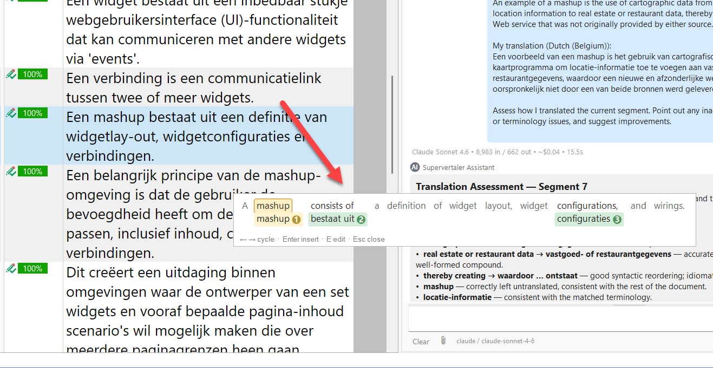

The **TermLens popup** is a borderless floating version of the docked TermLens panel for the active segment. Designed for keyboard-only term selection on small screens – and for translators who want to insert terms without ever reaching for the mouse.

<figure><figcaption>
The TermLens popup with the current match highlighted (amber ring on the source word)
</figcaption></figure>

### When to use it

* **Small screens / laptops** – keeping the docked TermLens panel always-visible can cost too much vertical space, especially for longer source sentences. The popup gives you the same view on demand and disappears when you're done.
* **Pure-keyboard workflows** – Alt+L, cycle, Enter, back to typing. No mouse, no menu hunting.

### Opening and closing

| Key                     | Action                                           |
| ----------------------- | ------------------------------------------------ |
| **Alt+L**               | Toggle the popup (open if closed, close if open) |
| **Escape**              | Close without inserting                          |
| Click outside the popup | Close without inserting                          |

You can change the key in **File → Options → Keyboard Shortcuts**. (Earlier versions listed **Ctrl+Alt+G**; that key now belongs to [AutoTagger](/trados/autotagger/).)

**Was a Ctrl tap until this version.** Pressing and releasing Ctrl on its own used to open the popup – a quick gesture, but not one Studio could tell apart from any other program's Ctrl-modified shortcut once something else had consumed the middle key. The popup opened by itself for anyone running a keyboard tool, a text expander or voice commands alongside Studio. Alt+L is unambiguous. If you preferred the tap, note that Studio remembers per-user shortcuts, so an existing installation keeps whatever you already had bound.

### Cycling between matches

When the popup opens, the first match has an amber ring around its source word – that is the **current match** that Enter will insert.

| Key                      | Action                                             |
| ------------------------ | -------------------------------------------------- |
| **Right** / **Tab**      | Move the current-match highlight to the next match |
| **Left** / **Shift+Tab** | Move it to the previous match                      |

Cycling wraps: from the last match, Right takes you back to the first.

**Up and Down have jobs of their own** (from v18/19.20.205). **Up** opens the current match for editing, like **E**, and **Down** shows or hides its details, like **I** – see [Editing a match](#editing-a-match) and [Showing a match's details](#showing-a-matchs-details) below. Before v18/19.20.205, Up and Down moved between matches, the same as Left and Right.

The line at the bottom of the popup lists the keys: "← → cycle · Enter insert · ↑/E edit · ↓/I info · Esc close".

### Inserting

| Key / action       | Result                                                                                             |
| ------------------ | -------------------------------------------------------------------------------------------------- |
| **Enter**          | Insert the current match into the target segment, close the popup, return focus to the target cell |
| **Click any chip** | Insert that match into the target segment, close the popup, return focus to the target cell        |

Both paths share the same insertion logic – there is no difference between picking by keyboard and picking by mouse.

### Editing a match

Press **E** – or **Up** (from v18/19.20.205) – while a match is highlighted to open the term-entry editor for that entry. The popup closes first so the editor opens with clean focus. The editor is the same dialogue the docked panel's right-click "Edit Term…" menu uses, including the multi-termbase editing case for entries that exist in more than one termbase.

:::note
**MultiTerm matches are read-only** in TermLens. Pressing E or Up on a green MultiTerm chip flashes a hint instead – edit those entries in **Trados → Termbase Viewer**.
:::

### Showing a match's details

Press **I** – or **Down** (from v18/19.20.205) – to show the details of the current match below its chip: synonyms, definition, domain, notes and links, the same details you see when you hover over a chip in the docked panel. Press I or Down again to hide them. The popup stays open, so you can still insert the match with Enter. Holding Down shows the details once; they don't flicker.

**Escape** with the details showing hides the details first; press it again to close the popup.

### Visuals

The popup uses the same chip rendering, colour scheme, and metadata indicators as the docked TermLens panel – pink for project termbase terms, blue for regular Supervertaler terms, yellow for non-translatable, green for MultiTerm. See the [TermLens overview](/trados/termlens/) for the full colour key.

### TermLens popup vs TermPicker

Both show the same matches for the active segment. Pick whichever fits your style:

|          | TermLens popup (Alt+L)                                 | [TermPicker](/trados/termlens/termpicker/) (Alt+P, or docked)              |
| -------- | ------------------------------------------------------ | ------------------------------------------------------- |
| Layout   | Source segment with chips underneath each matched word | Sortable, scrollable table                              |
| Best for | Skimming matches in segment context                    | Many matches that benefit from sorting / typing-to-jump |
| Keyboard | Left / Right / Tab cycle a highlighted match; Up edits it, Down shows its details | 0–9 jumps directly; Up / Down navigate                  |
| Modality | Modeless – click outside to dismiss                    | Modal – Escape or Cancel to close                       |

***

### See Also

* [TermLens overview](/trados/termlens/)
* [TermPicker](/trados/termlens/termpicker/)
* [Keyboard shortcuts](/trados/keyboard-shortcuts/)
