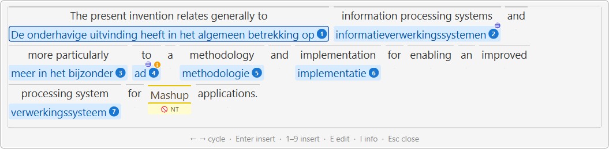

The **TermLens popup** is a borderless floating version of the docked TermLens panel for the active segment. It mirrors the panel's chips, colours, and metadata indicators exactly, but appears at the cursor on demand – designed for keyboard-only term selection on small screens, and for translators who want to insert terms without ever reaching for the mouse.

<figure><figcaption>
The TermLens popup floating at the cursor over the active segment, with the current match highlighted (blue ring around the chip). The docked TermLens panel on the right shows the same matches – the popup is its on-demand mirror.
</figcaption></figure>

### When to use it

* **Small screens / laptops** – keeping the docked TermLens panel always-visible can cost too much vertical space, especially for longer source sentences. The popup gives you the same view on demand and disappears when you're done.
* **Pure-keyboard workflows** – Ctrl tap, cycle, Enter, back to typing. No mouse, no menu hunting.

### Opening and closing

| Key                       | Action                                                |
| ------------------------- | ----------------------------------------------------- |
| **Ctrl** (tap)            | Toggle the popup (open if closed, close if open)      |
| **Esc**                   | Close without inserting                               |
| Click outside the popup   | Close without inserting                               |
| Move the mouse > 4 px     | Close (the popup is meant to be transient)            |

A "Ctrl tap" is a press-and-release of the Ctrl key on its own – no other key in between. Same memoQ-style trigger you might already use for the docked panel's Insert-by-number flow.

### Cycling between matches

When the popup opens, the first chip has a thin blue ring around it – that is the **current chip** that Enter will insert. The cycle skips bare source words; only chips you can actually insert get the highlight.

| Key                       | Action                                             |
| ------------------------- | -------------------------------------------------- |
| **Right** / **Tab**       | Move the current-chip highlight to the next chip   |
| **Left** / **Shift+Tab**  | Move it to the previous chip                       |

Cycling wraps: from the last chip, Right takes you back to the first.

**Up** and **Down** don't move between chips (from v1.10.375). **Up** edits the current chip, and **Down** shows its details; see below. Before v1.10.375, Up and Down did the same as Left and Right.

From v1.10.375, the line at the bottom of the popup lists the keys like this: “← → cycle · Enter insert · 1–9 insert · ↑/E edit · ↓/I info · Esc close · F1 help”.

### Inserting

| Key / action       | Result                                                                                                |
| ------------------ | ----------------------------------------------------------------------------------------------------- |
| **Enter**          | Insert the current chip into the target segment, close the popup, return focus to the target cell     |
| **1–9**            | Insert that-numbered chip directly (same numbering as the docked panel's Alt+N shortcut)              |
| **Click any chip** | Insert that chip into the target segment, close the popup, return focus to the target cell           |

All paths share the same insertion logic – there is no difference between picking by keyboard and picking by mouse.

### Editing a match

Press **E** or **Up** while a chip is highlighted to open the term-entry editor for that entry. (**Up** does this from v1.10.375.) The popup closes first so the editor opens with clean focus. The editor is the same dialogue the docked panel's right-click "Edit Termbase Entry…" menu uses, including the multi-termbase "Editing:" dropdown that lets you switch between sibling entries from other active termbases.

### Showing metadata

Press **I** or **Down** while a chip is highlighted to toggle the sticky metadata popup for that entry – the same hover popup the docked panel shows, with the entry's synonyms, abbreviations, definition, domain, notes, and URL fields. Press **I** or **Down** again to dismiss it. (**Down** does this from v1.10.375.)

### Visuals

The popup uses the same chip rendering, colour scheme, and metadata indicators as the docked TermLens panel:

| Chip style                     | Meaning                                          |
| ------------------------------ | ------------------------------------------------ |
| **Pink** background            | Project termbase term                            |
| **Blue** background            | Background termbase term                         |
| **Amber / yellow** background  | Non-translatable term                            |
| **Red** background + strikethrough | Forbidden term                               |
| **Purple** background          | Match via abbreviation (shows abbreviation pair) |
| **ℹ** corner indicator         | Entry has metadata (definition / domain / etc.)  |
| **≡** corner indicator         | Entry has synonyms                               |
| **+N** badge on chip           | N more cross-termbase entries available          |

See the [TermLens overview](/workbench/termbases/termlens/) for the full colour key.

### TermLens popup vs TermPicker

Both show the same matches for the active segment. Pick whichever fits your style:

|          | TermLens popup (Ctrl tap)                                | [TermPicker](/workbench/termbases/termpicker/) (Ctrl+Shift+P)              |
| -------- | -------------------------------------------------------- | ------------------------------------------------------- |
| Layout   | Source segment with chips underneath each matched word   | Numbered, scrollable table                              |
| Best for | Skimming matches in segment context                      | Many matches, picked by number                          |
| Keyboard | Left / Right / Tab cycle a highlighted chip              | 0–9 jumps directly; Up / Down navigate                  |
| Modality | Modeless – Esc / mouse move / click outside to dismiss   | Modal – Esc or Cancel to close                          |

***

### See Also

* [TermLens overview](/workbench/termbases/termlens/)
* [TermPicker](/workbench/termbases/termpicker/)
* [Keyboard Shortcuts](/workbench/editor/keyboard-shortcuts/)
