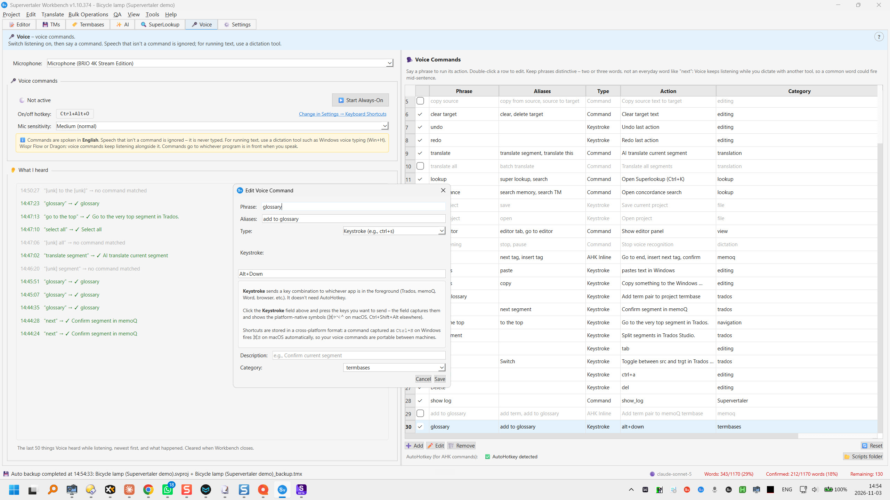

**Voice** lets you work by saying short commands, such as "next segment", "translate segment" or "undo". A command can do something in Workbench, or press keys in whichever program is in front: Trados, memoQ, Word or anything else. Voice runs offline, on your own computer.

Voice is for commands only. It never types what you say.

:::note[For running text, use a dictation tool]
To dictate your translation, use a dictation tool such as Windows voice typing (**Win+H**), [Wispr Flow](https://wisprflow.ai/) or Dragon. Voice keeps listening for commands while you dictate with it. Supervertaler for Trados works the same way with [SuperVoice](/trados/voice-commands/).

Workbench had its own dictation until v1.10.373. It was removed in v1.10.374.
:::

***

## Switching Voice on and off

Voice listens until you switch it off. There are three ways to switch it on or off:

- the **▶️ Start Always-On** / **⏹️ Stop Always-On** button on the **🎤 Voice** tab;
- **Ctrl+Alt+O**, from any program (⌘⌥O on a Mac);
- the grey microphone icon in the Windows system tray: click it, or right-click it and choose **▶ Start Always-On** or **⏹ Stop Always-On**. The icon turns red while Voice is listening. Its menu also has **🎤 Open Voice**, which opens the Voice tab.

The line next to the button shows what Voice is doing:

| Status | Meaning |
| --- | --- |
| ⚪ Not active | Voice is off. |
| ⏳ Starting… | Voice is loading its speech model. The first time, it downloads it first (about 40 MB). |
| 🟢 Listening for speech… | Voice is on and waiting for you to speak. |
| 🔴 Recording… | Voice hears you speaking. |
| ⏳ Processing… | Voice is working out what you said. |

If Voice stops by itself, for example because the microphone was unplugged, the status goes back to **⚪ Not active**. Click **▶️ Start Always-On** to start it again.

***

## What Voice understands

- **Commands are spoken in English**, whatever the languages of your project.
- **Voice only listens for the phrases in your command list.** Anything else is ignored and never typed: the status bar just says **No command matched**. So you can leave Voice on while you talk to a colleague or take a phone call.
- **Commands go to the program in front.** A command that presses keys, such as "undo", presses them in whichever program you are working in. Click into Trados, memoQ or Word before you speak. Commands that run a Workbench action, such as "translate segment", always act in Workbench.

### How a phrase is matched

- A command fires when you say its phrase, or one of its aliases, on its own. Capitals don't matter.
- A phrase of **two or more words** also fires when Voice hears it inside a longer sentence.
- A **one-word** phrase fires only when you say it on its own, never in the middle of a sentence.
- Voice never guesses. If what you said is close to a command but not the same, nothing happens.

:::caution[Choose distinctive phrases]
Voice keeps listening while you dictate with another tool, so a common word could fire a command in the middle of a sentence. Use two or three words: "next segment", not "next"; "confirm segment", not "okay".
:::

### What I heard

**What I heard**, under the on/off button, lists the last 50 things Voice heard, newest first, and what happened:

- **green**: a command ran, for example *"undo" → ✓ Undo last action*;
- **red**: a command was recognised but failed, for example because a key couldn't be sent;
- **grey**: no command matched. `[unk]` stands for words that aren't in your command list.

When a command didn't do what you expected, look here first. The list is cleared when Workbench closes.

***

## The built-in commands

These are the commands Voice starts with. You can change, switch off or remove any of them, and **🔄 Reset** brings back this list.

| Say | Or | What it does |
| --- | --- | --- |
| next segment | | Go to the next segment |
| previous segment | | Go to the previous segment |
| first segment | go to start | Go to the first segment |
| last segment | go to end | Go to the last segment |
| confirm | confirm segment | Confirm the segment and go to the next unconfirmed one |
| copy source | copy from source, source to target | Copy the source text to the target |
| clear target | delete target | Clear the target text |
| undo | | Press Ctrl+Z |
| redo | | Press Ctrl+Y |
| translate segment | translate this | Translate the segment with AI |
| translate all segments | batch translate | Translate all segments |
| lookup | super lookup | Open SuperLookup |
| concordance | search memory, search TM | Open the concordance search |
| save project | | Press Ctrl+S |
| open project | | Press Ctrl+O |
| show log | open log | Open the Log window |
| show editor | editor tab, go to editor | Go to the Editor tab |
| stop listening | | Switch Always-On off, like the **⏹️ Stop Always-On** button (from v1.10.375; before that it did nothing) |
| termbase | add term, add to termbase | memoQ: add a term pair to the termbase (Alt+Down) |
| tag next | next tag, insert tag | memoQ: go to the end of the segment, insert the next tag and confirm |
| confirm memoQ | confirm memo | memoQ: confirm the segment (Ctrl+Enter) |
| confirm trados | confirm studio | Trados Studio: confirm the segment (Ctrl+Enter) |

"undo", "redo", "save project" and "open project" press keys, so they act in the program in front. The memoQ and Trados commands need AutoHotkey (see [below](#autohotkey)).

If you used Voice before v1.10.374, your own list was kept as it was. Only "start dictation" was removed.

***

## Your own commands

The **Voice Commands** table on the right of the Voice tab lists all your commands:

| Column | What it shows |
| --- | --- |
| ☑ | Whether the command is on |
| Phrase | What you say |
| Aliases | Other phrases that do the same |
| Type | **Command**, **Keystroke**, **AHK Inline** or **AHK Script** |
| Action | The command's description, or what it does if it has none |
| Category | A label to group commands, such as *editing* or *memoq* |

Click a column heading to sort the table by that column.

### Adding, changing and removing commands

- **To add a command**, click **➕ Add**.
- **To change one**, double-click it, or select it and click **✏️ Edit**.
- **To remove one**, select it and click **🗑️ Remove**.
- **🔄 Reset** replaces your list with the built-in commands.

In the **Add Voice Command** or **Edit Voice Command** box:

- **Phrase**: what you say.
- **Aliases**: other phrases for the same command, separated by commas.
- **Type**: what the command does.
  - **Internal Action (Supervertaler)** runs a Workbench action. Pick it under **Preset**.
  - **Keystroke** presses keys in the program in front. Click the **Keystroke** field and press the keys, for example Ctrl+Enter. It doesn't need AutoHotkey. A keystroke recorded as Ctrl+S on Windows is sent as ⌘S on a Mac.
  - **AutoHotkey Code** runs a few lines of AutoHotkey v2 code, for example `Send "^{Enter}"`. Windows only.
  - **AutoHotkey Script File** runs an `.ahk` file, given by its full path. Windows only.
- **Description**: shown in the table's Action column.
- **Category**: pick one, or type your own.

The box explains what to fill in for the type you chose.

Changes take effect straight away, also while Voice is listening.

### Switching commands on and off

A command that is switched off is greyed out and never fires, but keeps its settings.

- **One command:** click its tick box.
- **All commands:** click the tick-box column's heading. This switches them all on, or all off if they are all on already.
- **Several commands:** select them with **Ctrl+click** or **Shift+click**, right-click and choose **✅ Activate** or **⬜ Deactivate**.

***

## Microphone and sensitivity

These are on the left of the Voice tab, and are saved as soon as you change them.

- **Microphone**: the microphone Voice listens to. **System default** uses the one selected in Windows. If the microphone you chose is unplugged, Voice uses the system default.
- **Mic sensitivity**: how loud a sound must be to count as speech.
  - **Low (noisy)**: ignores quiet background noise, but may miss soft speech.
  - **Medium (normal)**: the default, for a typical home office.
  - **High (quiet)**: picks up quiet voices, but may react to background noise.

***

## AutoHotkey

AutoHotkey v2 is only needed for the **AHK Inline** and **AHK Script** types, including the built-in memoQ and Trados commands. Under the commands table, Voice shows **✅ AutoHotkey detected** or **⚠️ AutoHotkey not found**.

**📂 Scripts folder** opens the `workbench\voice_scripts` folder in your data folder, a handy place to keep your `.ahk` files.

***

## The on/off hotkey

The hotkey is **Ctrl+Alt+O** (⌘⌥O on a Mac). It works from any program. To use another key, click **Change in Settings → Keyboard Shortcuts** on the Voice tab and change **Voice Always-On (toggle)**. Any key works, for example numpad **+**.

- **AltGr counts as Ctrl+Alt on Windows.** If AltGr+O types a character on your keyboard layout, you get the character and not the hotkey. Use the left Ctrl and Alt keys instead.
- **On a Mac**, global hotkeys need Accessibility permission. See [Keyboard Shortcuts](/workbench/settings/shortcuts/#per-platform-notes).

***

## Where Voice keeps its files

All in your data folder:

- your commands: `workbench\settings\voice_commands.json`;
- your AutoHotkey scripts: `workbench\voice_scripts\`;
- the English speech model: `vosk-models\`.

***

## Related pages

- [SuperVoice in Supervertaler for Trados](/trados/voice-commands/)
- [Keyboard Shortcuts](/workbench/settings/shortcuts/)
- [Data folder](/workbench/reference/data-folder/)
